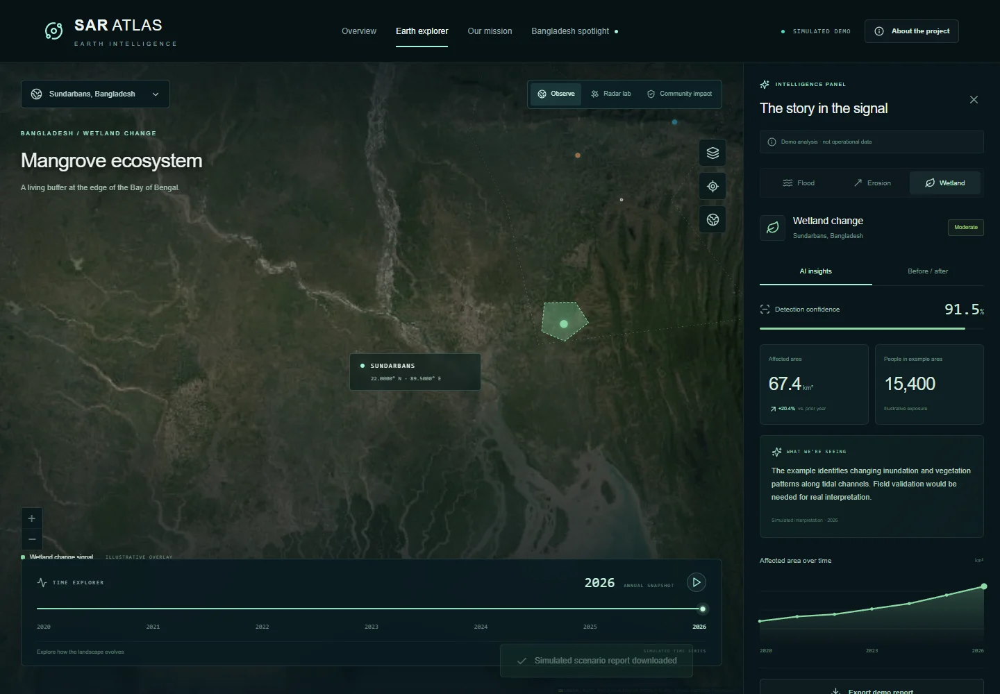
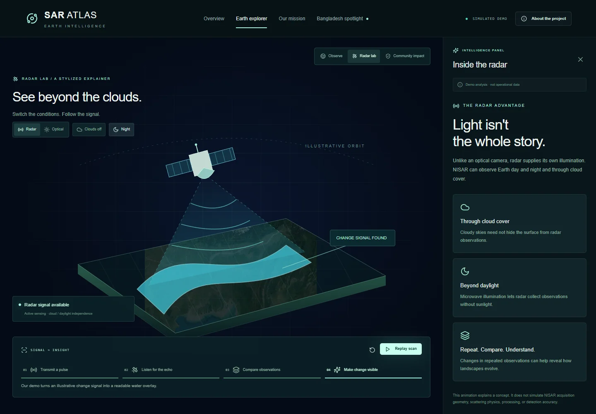
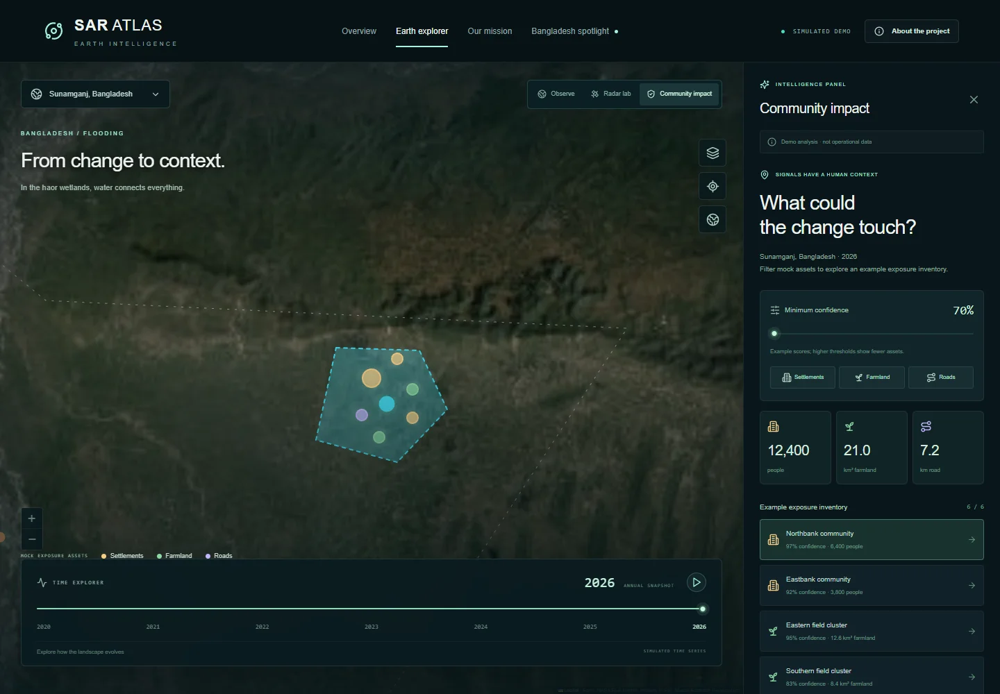

# SAR Atlas

**See change. Understand Earth.**

An interactive Earth observation frontend by **Cryocore Horizon**, created for **NASA Space Apps Challenge 2026 — Dancing with the SARs**.

SAR Atlas connects satellite observation concepts with the landscapes and communities of Bangladesh. Explore flooding in Sunamganj, riverbank erosion along the Jamuna, and wetland change in the Sundarbans through maps, visual comparisons, timelines, and an interactive radar explainer.



This repository contains the runnable frontend demo, bundled imagery, and browser tests. Analysis values, change overlays, observation dates, and community exposure estimates are illustrative. The application does not process actual NISAR acquisitions or run an inference model.

## Quick start

### Requirements

- Node.js **20.9 or newer** and npm.
- A modern browser.
- Google Chrome for the included Playwright test configuration.

```bash
git clone https://github.com/electr0x0/cryocore-horizon-spaceapps-2026.git
cd cryocore-horizon-spaceapps-2026
npm ci
npm run dev
```

Open **http://127.0.0.1:3000**.

No environment variables, API keys, database, or external data service are required. Dependency installation needs internet access; the running application serves its imagery locally. The development server binds to the local machine by default.

## Features

### Earth overview

An animated Earth, regional spotlight, and mission cards introduce the three environmental themes. **Explore Earth** opens the workspace. **Watch the mission** starts the guided walkthrough. The project dialog explains the imagery and data represented in the interface.

### Interactive Earth explorer

- Choose a scenario through the region selector, scenario buttons, or map markers.
- Pan and zoom the Leaflet map, then recenter on Bangladesh.
- Toggle the satellite basemap, simulated detection overlays, and reference labels.
- Inspect color-coded footprints and location information.
- Switch to a global view featuring Bangladesh, the Amazon Basin, the Mekong Delta, and the Nile Delta.

### Timeline and before/after comparison

The **2020–2026 timeline** supports year selection, a draggable slider, and play/pause controls. Changing the year updates the illustrative footprint, affected-area figure, and chart highlight together.

The **Before / after** tab provides a draggable comparison and an expanded view. Both sides use the same static satellite basemap; a simulated overlay supplies the visual difference. Year labels represent demo states rather than acquisition dates for the basemap.

### Insight panel and reports

The insight panel pairs a predefined interpretation with an example confidence score, severity, affected area, and trend. **Export demo report** downloads the selected scenario and year as JSON, including the data disclaimer.

### Radar Lab



Switch between **Optical** and **Radar**, toggle cloud cover and day/night conditions, and run an animated observation sequence. Controls support pause, replay, reset, and individual scan steps.

The four stages explain transmitting a pulse, receiving an echo, comparing observations, and revealing a change signal. The scene illustrates concepts; it does not simulate scattering physics, acquisition geometry, signal processing, or detection accuracy.

### Community Impact



Connect an illustrative change signal with fictional settlements, farmland, and roads:

- Filter the inventory by minimum confidence and asset category.
- Change the year to reveal different example assets.
- Select an inventory item or map marker to focus on that asset.
- Inspect exposure totals and the selected asset's description.
- Export the filtered inventory and settings as JSON.

The inventory and exposure values are precomputed demo data, not a live spatial intersection, population dataset, or operational risk assessment.

### Responsive interaction

The interface adapts to desktop and mobile screens. Named controls, keyboard-operated sliders, Radix UI dialogs and tabs, and reduced-motion handling support navigation. Browser tests check mobile navigation and horizontal overflow alongside desktop interactions.

## Regional scenarios

| Scenario | Location | Demonstrated change |
| --- | --- | --- |
| Flooding | Sunamganj, Bangladesh | Illustrative water expansion across the haor landscape |
| Riverbank erosion | Sirajganj and the Jamuna corridor, Bangladesh | Example riverbank retreat and changing land exposure |
| Wetland change | Sundarbans, Bangladesh | Illustrative inundation and vegetation patterns |

Each scenario defines its map center, color, polygon, seven annual values, severity, confidence, and explanatory text in [`lib/scenarios.ts`](lib/scenarios.ts).

## Four-minute guided walkthrough

Select **Watch the mission** to start a **240-second interactive walkthrough**. The floating controls support pause, resume, restart, exit, and chapter selection. Workspace controls remain usable during playback.

| Time | Chapter |
| --- | --- |
| 00:00–00:30 | Our changing Earth |
| 00:30–01:00 | Flood detection |
| 01:00–01:40 | Inside the radar |
| 01:40–02:10 | Compare the change |
| 02:10–02:35 | A shifting river |
| 02:35–03:15 | From signals to communities |
| 03:15–03:45 | Protecting wetlands |
| 03:45–04:00 | One planet. A shared future. |

Chapters are configured in [`lib/presentation.ts`](lib/presentation.ts). The walkthrough stops at 04:00 and can be restarted from its controls.

## Technology

| Area | Implementation |
| --- | --- |
| Application | Next.js 16 App Router and React 19 |
| Language | TypeScript with strict type checking |
| Styling | Tailwind CSS 4 and custom responsive CSS |
| UI primitives | Radix UI with shadcn-style local components |
| Maps | Leaflet and React Leaflet |
| Motion | Framer Motion and CSS animation |
| Icons | Lucide React |
| Image preparation | Sharp |
| Browser testing | Playwright |
| Distribution | Static HTML, CSS, JavaScript, and bundled images |

Use the committed `package-lock.json` with `npm ci` for reproducible dependency installation.

## Project structure

```text
app/
  layout.tsx                 Root layout and page metadata
  page.tsx                   Main experience and application state
  globals.css                Core styling and responsive layout
  demo-features.css          Radar Lab and Community Impact styling
components/
  earth-map.tsx              Leaflet map, overlays, markers, and camera
  comparison.tsx             Comparison slider and expanded view
  animated-number.tsx        Animated metric display
  radar-lab.tsx              Radar explainer and scan controls
  impact-panel.tsx           Asset filters, inventory, and exposure panel
  ui/                       Shared interactive components
lib/
  scenarios.ts              Regional scenarios and annual values
  impact.ts                 Fictional assets and filtering helpers
  presentation.ts           Guided walkthrough chapters
  utils.ts                  Styling utilities
public/images/              Bundled Earth textures and Bangladesh basemap
docs/images/                Interface screenshots used in this README
scripts/prepare-assets.mjs  Optional imagery preparation utility
tests/demo.spec.ts          Desktop, mobile, and interaction tests
next.config.ts              Static export configuration
playwright.config.ts        Browser test configuration
```

## Application architecture

The main page owns the scenario, observation year, active workspace, layer settings, and walkthrough state. Components receive that state and update it through callbacks. Scenarios and the fictional asset inventory are defined in local TypeScript modules.

The Leaflet map loads on the client and uses bundled image overlays instead of requesting map tiles at runtime. Scenario polygons scale with the illustrative annual value. The impact inventory is filtered by year, confidence, and enabled categories.

JSON reports are created and downloaded in the browser. There is no account system, server API, database, or persistent user storage. Reloading the page restores the initial demo state.

## Development and testing

| Command | Purpose |
| --- | --- |
| `npm ci` | Install dependencies from the lockfile |
| `npm run dev` | Start the development server at `127.0.0.1:3000` |
| `npm run typecheck` | Check TypeScript without emitting files |
| `npm run build` | Build and export the application to `out/` |
| `npx playwright test` | Run four browser tests against a running server |
| `node scripts/prepare-assets.mjs` | Regenerate local imagery; requires network access |

### Browser tests

Playwright uses **Google Chrome** and expects the application to be running separately on port 3000. Start the server in one terminal:

```bash
npm run dev
```

Run the checks in another terminal:

```bash
npm run typecheck
npx playwright test
```

Install Google Chrome first if it is unavailable. To test on a different port, update `baseURL` in `playwright.config.ts`.

Tests cover scenarios, layers, timeline playback, comparison controls, report downloads, Radar Lab conditions, community filters, the exact 240-second walkthrough, and mobile navigation. Screenshots go to `artifacts/`; Playwright output goes to `test-results/`. Both generated directories are excluded from Git.

## Build and deployment

```bash
npm ci
npm run build
```

`next.config.ts` enables `output: 'export'`. The build writes the static site to **`out/`**, which can be published with a static host or HTTP server.

| Hosting setting | Value |
| --- | --- |
| Install command | `npm ci` |
| Build command | `npm run build` |
| Publish/output directory | `out` |
| Environment variables | None required |

Serve the build over HTTP rather than opening `out/index.html` directly from the filesystem. A production Node.js server is not required for the exported site.

Image URLs assume deployment at the domain root. A repository subpath, such as a GitHub Pages project URL, requires base-path configuration and updates to root-relative asset URLs before deployment.

## Data sources and interpretation

| Source | Use |
| --- | --- |
| [NASA Blue Marble](https://science.nasa.gov/earth/earth-observatory/collections/blue-marble/) | Earth visualization and global image overlay |
| [NASA NISAR mission concept](https://science.nasa.gov/mission/nisar/mission-concept/) | Reference for the Radar Lab explanation |
| [Esri World Imagery](https://www.arcgis.com/home/item.html?id=10df2279f9684e4a9f6a7f08febac2a9) | Static Bangladesh satellite basemap |

Map credits identify **NASA Blue Marble** and **Esri, Maxar, Earthstar Geographics**. Preserve those credits when adapting the interface.

- Detection footprints, dates, confidence, severity, trends, and impact figures are hardcoded illustrative values.
- No actual NISAR acquisition is downloaded, processed, or analyzed.
- Before/after views share a static basemap rather than dated acquisitions.
- Community assets are fictional, and boundaries are approximate visual guides.
- Radar Lab explains concepts rather than modeling radar physics.

Real monitoring would require observations, preprocessing, validated detection methods, reference data, and uncertainty assessment. Displayed results are not intended for emergency response or operational decisions.

### Optional imagery regeneration

The three required image files are already included in `public/images/`:

```bash
node scripts/prepare-assets.mjs
```

This optional utility downloads the NASA texture, creates a Web Mercator version, and assembles the Bangladesh mosaic from Esri tiles. It requires internet access and overwrites the three bundled image assets. It is not needed for normal installation, development, or deployment.

## Customization

| Change | Files |
| --- | --- |
| Regional descriptions, centers, polygons, and annual values | `lib/scenarios.ts` |
| Fictional assets, units, colors, and filter logic | `lib/impact.ts` |
| Walkthrough chapter timing and workspace selection | `lib/presentation.ts` |
| Page composition, state, and report contents | `app/page.tsx` |
| Theme and responsive layouts | `app/globals.css`, `app/demo-features.css` |
| Radar animation and explanations | `components/radar-lab.tsx` |
| Page title and description | `app/layout.tsx` |

Keep simulation labels consistent with the data shown. The map assumes seven annual entries for 2020–2026; changing that range also requires updating the timeline and indexing logic. Adding a region requires updating both its scenario definition and the map's selectable markers.

## Team

**Cryocore Horizon — Explore. Innovate. Discover.**

| Team member | Role |
| --- | --- |
| Afzal Hossain Alif | Team Lead — ML & AI |
| Abbas Yasin | Backend Engineer |
| Jahidul Hossain Mekat | Full Stack Engineer |
| Mojtoba Zaman Mantaka | Video Editing, Graphics & VFX |
| Nusaiba Jahan | Researcher |
| Aiman Saad Hamid | Data Analyst |

Created for **NASA Space Apps Challenge 2026**, challenge category **Dancing with the SARs**. SAR Atlas is an independent team project and is not an official NASA product.
